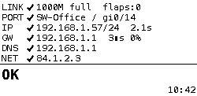
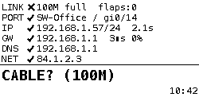
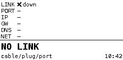
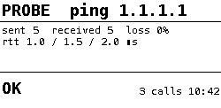

# ethtester

A pocket Ethernet tester built from a Raspberry Pi Zero, a USB Ethernet dongle and a Waveshare 2.13" e-ink HAT. Plug it into a wall socket or switch port, and the screen shows how far the connection gets (link, switch port, DHCP, gateway, DNS, internet) and what is most likely at fault.

It also runs an MCP server and ships a command-line client, so Claude Code (or you) can run extra probes through the tester's Ethernet port while you move it between plugs.

<p>
  
  
  
  
</p>

<sub>Previews rendered on a Mac with a substitute font; on the Pi the screen uses DejaVu Sans Mono.</sub>

## What the screen tells you

| Screen says | Likely cause |
|---|---|
| `NO LINK` | Cable, wall plug, or dead switch port |
| `CABLE? (100M)` | Damaged cable/termination (gigabit fell back to 100) |
| `FLAPPING` | Loose plug or worn connector |
| `NO DHCP` | Router/DHCP, or port on the wrong VLAN |
| `GATEWAY` | Router or VLAN configuration |
| `DNS` | DNS server |
| `NO INTERNET` | Router's uplink |

Each row on the Ethernet screen (`LINK`, `PORT`, `IP`, `GW`, `DNS`, `NET`) shows ✓, ✗ or – for skipped. The first failing row points at the fault. `PORT` shows the switch name and port when the switch speaks LLDP.

When a probe runs through the MCP server or the CLI, the display switches to a **probe screen** with the probe and its result. It switches back when the Ethernet status changes or after 5 minutes.

## Hardware

- Raspberry Pi Zero 2 W (other Zero models work; Wi-Fi is handy for SSH and the remote features)
- USB Ethernet dongle on the micro-USB data port. A gigabit dongle (e.g. RTL8153) can spot the "gigabit dropped to 100" cable fault; a 10/100 dongle (RTL8152) can't, so set `expected_speed = 100` for it.
- Waveshare 2.13" e-Paper HAT, V4 (V3 also supported), 250×122, black and white

Limitations: it can't measure PoE (use an inline PoE tester). LLDP needs a managed switch.

## Install

1. Flash **Raspberry Pi OS Lite** (64-bit, Bookworm or Trixie) with Raspberry Pi Imager. Use 32-bit on an original Pi Zero / Zero W. Enable SSH, set a user and add your Wi-Fi.
2. Copy this repository to the Pi: `scp -r ethernet-tester <user>@<pi-ip>:`
3. On the Pi: `sudo ethernet-tester/deploy/install.sh`
4. Check `/boot/firmware/ethtester.toml`: `display` must match the sticker on the back of the HAT (default `"V4"`), and set `expected_speed = 100` for a 10/100 dongle.
5. Reboot (the first install enables SPI).

To update, copy the folder over again and re-run `install.sh`. It updates the network profile and restarts the services, so no reboot is needed.

`install.sh` accepts repeatable `--set key=value` options that edit `/boot/firmware/ethtester.toml` first (keys: `interface`, `display`, `expected_speed`, `mcp_port`, `mcp_bind`, `mcp_clients`, `mcp_auth`):

```
sudo deploy/install.sh --set expected_speed=100 --set mcp_bind=wlan0 --set mcp_clients=lan
```

Logs: `journalctl -u ethtester` and `journalctl -u ethtester-mcp` for errors, `/var/log/ethtester/ethtester.log` for the state history, `/var/log/ethtester/probes.log` for every remote probe.

## How it works

- `ethtester` (systemd service) polls every 5 s (every 0.5 s while the link is down or waiting for DHCP). It reads link state from sysfs, the switch port from `lldpd`, the lease from NetworkManager, then pings the gateway and does DNS and HTTPS checks. **Every check is bound to the tested interface**, so Wi-Fi can never make a dead port look healthy.
- It detects plug swaps, including fast ones, and forces a fresh DHCP lease on each new plug. It also has a systemd watchdog and survives display or config errors.
- The NetworkManager profile for the tested port retries DHCP forever and has a low route priority, so the Pi's own traffic stays on Wi-Fi.

## Remote probes (MCP server)

`ethtester-mcp` serves 11 tools over streamable HTTP: `get_status`, `get_history`, `get_link_details`, `ping`, `traceroute`, `dns_lookup`, `http_check`, `dhcp_renew`, `link_control`, `neighbour_scan`, `speed_test`. Every probe runs through the tested Ethernet port only, inputs are validated, and nothing goes through a shell. `dhcp_renew`, `link_control` and `neighbour_scan` share a lock. Forced link speeds keep autonegotiation on and revert automatically.

Choose how it's reached in `/boot/firmware/ethtester.toml`:

| Setting | Meaning |
|---|---|
| `mcp_bind = "tailscale"` (default) | Listen only on the Pi's Tailscale address. Run `sudo tailscale up` once on the Pi. |
| `mcp_bind = "wlan0"` | Listen on the Wi-Fi address (home network only). Give it a DHCP reservation. |
| `mcp_clients = "tailscale"` / `"lan"` | Accept Tailscale addresses only, or also private LAN ranges. |
| `mcp_auth = "token"` (default) / `"none"` | Require the bearer token from `/etc/ethtester/mcp-token`, or no token. |

The installer prints the matching `claude mcp add …` command when it finishes. It also adds an nftables rule that drops connections to the MCP port on the tested interface.

**About `mcp_auth = "none"`:** anyone who can reach the server can run probes (ping, traceroute, ARP scans, DHCP renew, link changes) through the tester. Only use it on a network you fully trust. To rotate the token, delete `/etc/ethtester/mcp-token` and re-run the installer.

## Command-line client

`scripts/ethtester` talks to the MCP server over HTTP. It needs only Python 3.11+ and no other dependencies, so Claude Code can call it through Bash. `CLAUDE.md` tells Claude how.

```
ln -s "$PWD/scripts/ethtester" ~/.local/bin/ethtester
ethtester configure --url http://<pi-wifi-or-tailscale-ip>:8765/mcp   # paste the token when asked, or leave it empty
ethtester status
ethtester ping 1.1.1.1 -c 10
ethtester dns example.com -t AAAA --server 1.1.1.1
ethtester link-control force-10 --duration 30
ethtester speedtest <host running iperf3 -s> --reverse
```

Output is JSON. Exit codes: 0 OK, 1 probe failed, 2 connection or config error. Settings live in `~/.config/ethtester/cli.toml` (mode 0600), and `ETHTESTER_URL`, `ETHTESTER_TOKEN` and `--url`/`--token` override them.

## Development

```
python3 -m venv .venv
.venv/bin/pip install pillow pytest "mcp==1.30.0" "uvicorn>=0.30"
.venv/bin/pytest
```

The tests run on macOS or Linux without hardware. Sample screens are written to `tests/output/`. Design notes and implementation plans are in `docs/superpowers/`. See [CONTRIBUTING.md](CONTRIBUTING.md).

## License

MIT, see [LICENSE](LICENSE). The vendored Waveshare driver in `ethtester/vendor/waveshare_epd/` keeps its own MIT-style notice; see its [README](ethtester/vendor/waveshare_epd/README.md) for the local change.
